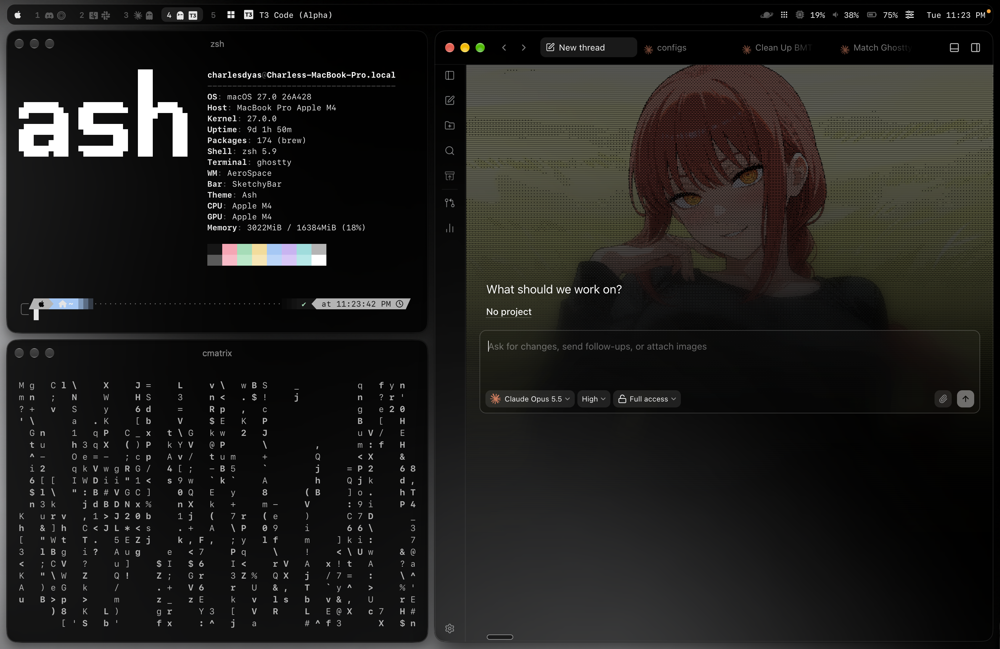
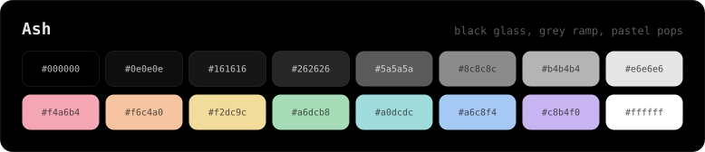

# dotfiles



My macOS setup, managed with [yadm](https://yadm.io). The repo's work tree is my actual home directory, so these are real files sitting where they belong. No symlink farm to babysit, and a new machine gets dressed in one command.

## Ash

I paint my own terminal palettes. The current one is **Ash**: black glass, a plain grey ramp, and pastel color only where it carries meaning. It replaced Voltage, which was louder than it needed to be.



The top row is the grey ramp, from the black glass up to the text color. The bottom row is the pastels: rose, peach, butter, mint, aqua, sky, lilac, plus pure white. Hover and selection are white washes (5% and 10%), borders are 7% white hairlines, and sky `#a6c8f4` is the one accent.

It's built to match my [T3 Code glass build](https://github.com/dyascj/t3code/tree/glass), so the terminal and the browser read as the same app. Ghostty reads the palette from `.config/ghostty/ash.conf` and dresses like T3 in `config`: black glass at 85% with a 23px blur, SF Mono, tabs in the title bar, roomy padding, and a matching dock icon. Zen Browser wears it as a `userChrome.css` in `.config/zen/chrome/`, riding Zen's native macOS vibrancy on the clear fullScreenUI material with a 55% black wash on top, a touch lighter than T3's black glass. The acrylic url bar and compact sidebar float over it.

Zed has a full theme at `.config/zed/themes/ash.json` with a blurred window. VS Code gets the colors through `workbench.colorCustomizations` and `editor.tokenColorCustomizations` in `settings.json`, on solid black. btop has a transparent variant in `.config/btop/themes/ash.theme` with grey boxes and pastel graphs.

The menu bar is [SketchyBar](https://github.com/FelixKratz/SketchyBar), in `.config/sketchybar/`. It floats as a strip of black glass with a 7% hairline, everything grey until it's active, then white. On the left sit the Spaces that are in use, each with icons for the apps open in it, and the app in front. On the right are Vorssaint, Tailscale, CPU, volume, battery, a Control Center and the clock. The only color is rose on the battery when it's low and unplugged.

The Apple logo, Tailscale and Control Center open popup menus in the same black glass, with rows that light up under the mouse. The Apple menu does what the real one does. Tailscale's switches the connection, copies the IP of this Mac or any of my devices, and turns the exit node on with Tailscale's suggestion or off again. Control Center mirrors the stock one: Wi-Fi, Bluetooth, AirDrop, Focus, Dark Mode, Screen Mirroring and Capture Screen, brightness and volume sliders, every sound output with AirPods battery and a tap to connect them, and what's playing. macOS has no command line for half of that, so `.config/sketchybar/helpers/ccctl.swift` does it, built into `~/.cache` the first time the bar starts. Focus runs a Shortcut named Toggle Focus. AirPods noise control isn't something macOS lets anything but its own Control Center change. Vorssaint's icon opens its own panel. That clicks the hidden menu bar icon, so sketchybar needs Accessibility in System Settings. Force Quit uses the real shortcut for the same reason, and falls back to Activity Monitor without it. The bar sits above the real menu bar, so it still slides down at the top edge but never covers the bar. One palette, six surfaces.

## Tiling

Windows tile with [AeroSpace](https://github.com/nikitabobko/AeroSpace) across five workspaces, with 10pt gaps that line up with the bar. The config lives in `.config/aerospace/aerospace.toml`, and the smart stacking and free mode behind it in `.config/aerospace/mode.sh`.

### Smart stacking

A new window splits the window you're in, and each split turns the other way from the last. Windows spiral into a grid instead of piling into thin strips:

```
1 window      2 windows      3 windows       4 windows
┌───────┐     ┌───┬───┐      ┌───┬───┐       ┌───┬───┐
│       │     │   │   │      │   │ 2 │       │   │ 2 │
│   1   │     │ 1 │ 2 │      │ 1 ├───┤       │ 1 ├─┬─┤
│       │     │   │   │      │   │ 3 │       │   │3│4│
└───────┘     └───┴───┘      └───┴───┘       └───┴─┴─┘
```

- **Pick where it lands.** The new window splits whichever window is focused, so click the one it should share space with before opening it. Open from 1 instead of 3 above and you get a 2x2 grid.
- **Tidy up** (⌥= or the layout menu) rebuilds the workspace you're on into the spiral and evens out the sizes. Use it when a workspace gets messy, or after dragging windows in from another one.
- **Flip** (⌥/) turns a split sideways when a pair would read better stacked, or side by side.
- **Two to four windows** per workspace is the sweet spot on a 14" screen. Past that, apps hit their minimum sizes (Finder won't go below about 480pt wide) and start spilling off the edge.

### Free mode

⌥T floats every window so it moves and resizes like stock macOS, and new windows float too. Press it again and everything snaps back into the smart stack. Workspaces work the same in both, and the grid icon on the bar turns into two overlapping windows while free mode is on. System Settings always floats.

### Controls

Everything is a click away on the bar, and every shortcut is Option-based. The grid icon beside the workspaces opens a menu with free mode and the window commands, each showing its shortcut, so the keys can be picked up along the way.

| Mouse or keys | Does |
| --- | --- |
| Click a workspace on the bar, or ⌥1 to ⌥5 | Go to that workspace |
| Right-click a workspace, or ⌥⇧1 to ⌥⇧5 | Send the window you're in there |
| ⌥⇥ | Back to the last workspace |
| ⌥T | Tiling or free mode |
| ⌥F | Float or tile just this window |
| ⌥↩ | Fullscreen |
| ⌥/ | Flip the split |
| ⌥= | Tidy up: smart stack and even out sizes |
| ⌃⌥ arrows | Move the window left, right, up or down |

Option alone with the arrows is left for jumping by word in text.

The focused window wears a soft white line from [JankyBorders](https://github.com/FelixKratz/JankyBorders) (`.config/borders/bordersrc`), so it's clear which window the next one will split.

My Keychron has no right Option key, so right Control stands in for it. A LaunchAgent in `Library/LaunchAgents/local.keyboard.right-option.plist` remaps it with `hidutil` at every login. The Mac's own keyboards have no right Control, so they're untouched.

## What's inside

| Tool | Where |
| --- | --- |
| [Ghostty](https://ghostty.org) | `.config/ghostty/` |
| VS Code | `Library/Application Support/Code/User/settings.json` |
| zsh | `.zshrc`, `.zprofile` |
| [powerlevel10k](https://github.com/romkatv/powerlevel10k) | `.p10k.zsh` |
| [Zed](https://zed.dev) | `.config/zed/` |
| [Zen Browser](https://zen-browser.app) | `.config/zen/chrome/userChrome.css` |
| [T3 Code](https://github.com/dyascj/t3code/tree/glass) (glass fork) | cloned by bootstrap |
| btop | `.config/btop/` |
| [AeroSpace](https://github.com/nikitabobko/AeroSpace) | `.config/aerospace/` |
| [SketchyBar](https://github.com/FelixKratz/SketchyBar) | `.config/sketchybar/` |
| neofetch | `.config/neofetch/` |
| Homebrew | `.Brewfile` |

## New machine

```sh
/bin/bash -c "$(curl -fsSL https://raw.githubusercontent.com/Homebrew/install/HEAD/install.sh)"
eval "$(/opt/homebrew/bin/brew shellenv)"
brew install yadm
yadm clone https://github.com/dyascj/dotfiles.git
yadm bootstrap
```

Homebrew comes first because yadm installs through it. `yadm clone` puts every file where it belongs, and the [bootstrap script](.config/yadm/bootstrap) handles the rest:

- `brew bundle --global` installs everything in the Brewfile, apps included (Ghostty, Zen, Zed, VS Code, AeroSpace, Sol, Tailscale, Vorssaint). A failed package gets reported and the setup keeps going.
- Copies SF Mono out of Terminal.app so Ghostty can use it.
- Installs my VS Code extensions from a saved list.
- Clones my [T3 Code glass fork](https://github.com/dyascj/t3code/tree/glass) into `~/Developer/t3code-glass`, links `t3-glass-update` into `~/.local/bin`, and sets up the private Rust toolchain it builds with. Run `t3-glass-update` afterwards to build and install the app (it takes a few minutes).
- Sets zsh as the default shell.
- Hides the macOS menu bar and starts SketchyBar in its place. Its first start builds the Control Center helper from source.
- Starts AeroSpace, which starts itself at every login after that.

A few things only macOS can say yes to, so they wait for me after bootstrap:

- **Privacy & Security > Accessibility:** turn on AeroSpace, or nothing tiles. Turn on `sketchybar` too, for Vorssaint's panel and the real Force Quit window.
- **Prompts on first use:** let `ccctl` use Bluetooth (AirPods in Control Center) and let SketchyBar control System Events (Dark Mode).
- **Shortcuts:** make one called Toggle Focus with a Set Focus action that toggles Do Not Disturb, for the Focus switch.
- **Tailscale:** sign in.

Zen hides its config behind a machine-specific profile folder, so it's the one exception to the no-symlinks rule: bootstrap finds the active Zen profile, links `userChrome.css` in from `.config`, and turns on the prefs the theme needs. Zen has no profile until it's opened once, so launch it, quit it, and run `yadm bootstrap` again to wire it up. Every step skips what's already done, so rerunning is safe.

## Day to day

yadm is just git with your home directory as the work tree, so the muscle memory carries over:

```sh
yadm status
yadm add .config/ghostty/ash.conf
yadm commit -m "warmer cursor"
yadm push
```

Machine-specific stuff never touches the repo. `.zshrc` sources an untracked `~/.zshrc.local` at the end if one exists.
